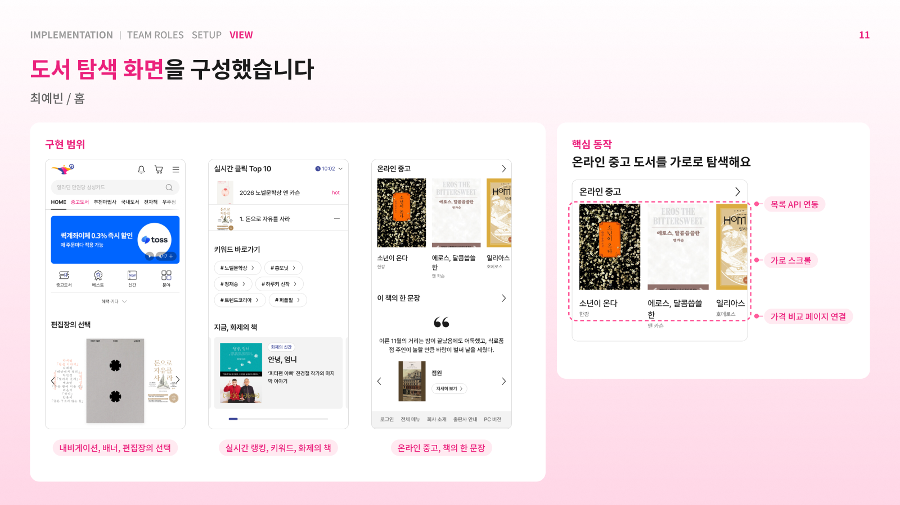
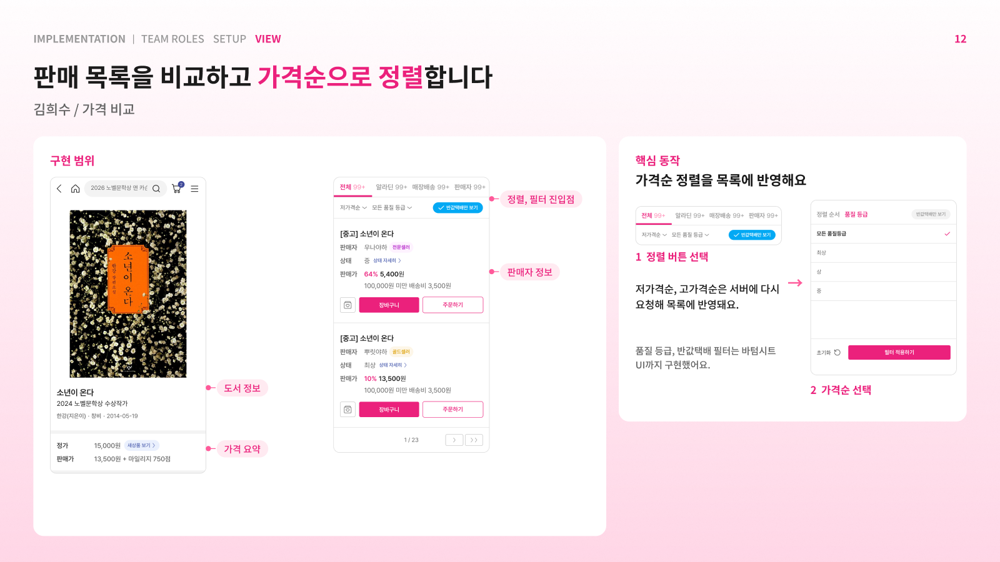
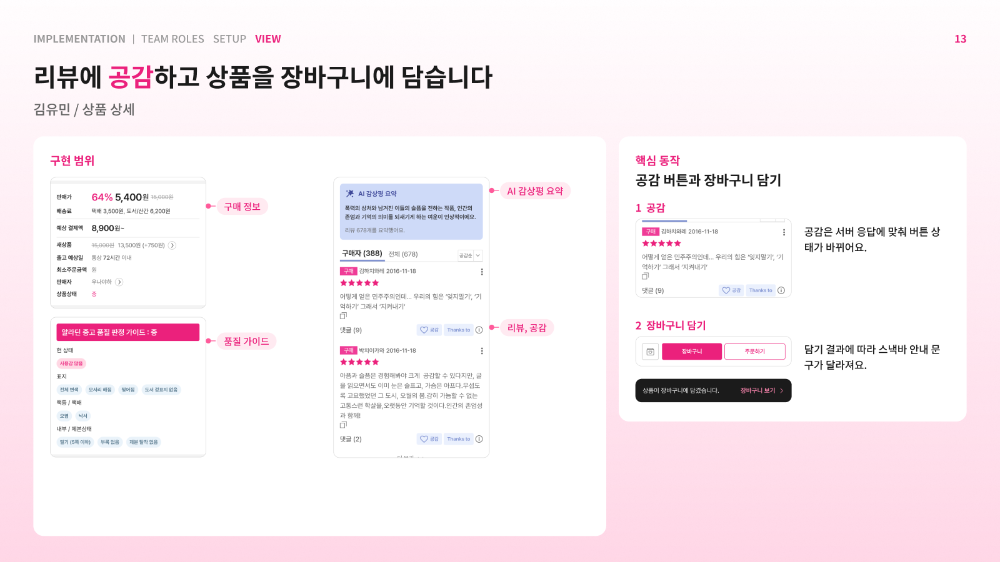
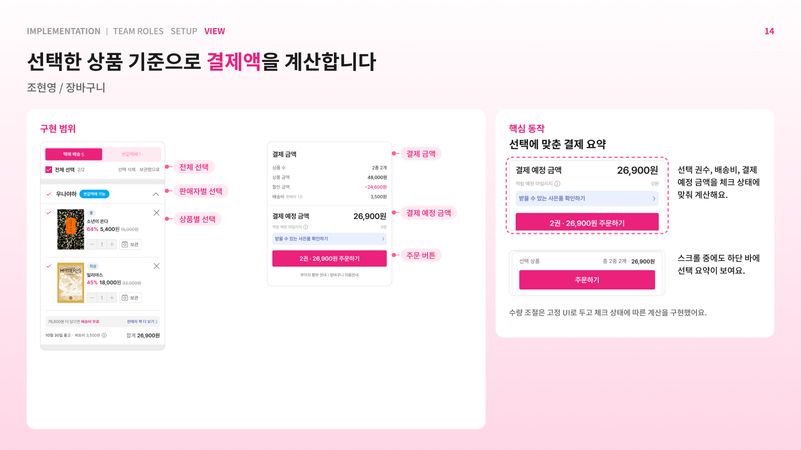

# 📚 알라딘 — 모바일 웹 3조

**PLAY SOPT 39기 합동세미나 · 중고 도서 구매 여정 리디자인**

> 책을 고르는 순간부터, 구매를 결정하는 순간까지.

[배포 사이트](https://39-collaboration-web-aladin.vercel.app/) · [발표 자료](https://www.figma.com/design/LfuQcw27pnKusEyxdoraP1?node-id=0-1)

[프로젝트 소개](#프로젝트-소개) · [구매 여정과 구현 기능](#구매-여정과-구현-기능) · [구현 화면](#구현-화면) · [팀과 역할](#팀과-역할) · [개발 환경](#개발-환경) · [협업 규칙](#협업-규칙)

<br>

## 프로젝트 소개

알라딘은 신간과 중고 도서를 탐색하고 구매할 수 있는 온라인 서점입니다.

알라딘 모바일 웹에서 **중고 도서를 찾고, 판매 조건을 비교하고, 구매할 상품을 선택하는 과정**을 다듬었습니다.

홈의 탐색 진입점부터 판매자별 가격 비교, 책 상태 확인, 장바구니의 결제 요약까지 네 화면을 연결해 구현했습니다.

<br>

## 구매 여정과 구현 기능

**01 책 찾기 → 02 판매 조건 비교 → 03 책 상태 확인 → 04 선택 상품 모아보기**

| 구매 단계 | 화면 | 구현한 내용 |
| --- | --- | --- |
| 01 · 책 찾기 | 홈 | 추천·랭킹·키워드 등 탐색 UI, 온라인 중고 도서 목록 API 및 가로 스크롤 |
| 02 · 판매 조건 비교 | 가격 비교 | 판매자별 상품 목록과 가격순 정렬, 필터 바텀시트 UI |
| 03 · 책 상태 확인 | 상품 상세 | 판매가·배송비·품질 가이드, 리뷰 공감, 장바구니 담기 |
| 04 · 선택 상품 모아보기 | 장바구니 | 전체·판매자별·개별 선택, 배송비와 결제 예정 금액 계산 |

<br>

## 구현 화면

발표 장표를 통해 화면별 구현 내용과 담당 영역을 확인할 수 있습니다. 이미지를 클릭하면 크게 볼 수 있습니다.

| 홈 · 최예빈 | 가격 비교 · 김희수 |
| :---: | :---: |
| [](docs/images/presentation/home.png) | [](docs/images/presentation/compare.png) |
| 탐색 콘텐츠 UI · 온라인 중고 목록과 가로 스크롤 | 바텀시트 · 가격순 정렬 |
| **상품 상세 · 김유민** | **장바구니 · 조현영** |
| [](docs/images/presentation/detail.png) | [](docs/images/presentation/cart.png) |
| 상품 상세 조회 · 리뷰 공감 · 장바구니 담기 연결 | 선택 상태에 따른 금액 계산 · 하단 주문 바 |

<br>

### 화면을 연결하는 API

| 기능 | Method | Endpoint | 담당자 |
| --- | --- | --- | --- |
| 온라인 중고 도서 목록 조회 | `GET` | `/v1/books/online-used` | 최예빈 |
| 중고 판매 상품 목록 조회 | `GET` | `/v1/books/{bookId}/sellers` | 김희수 |
| 중고 상품 상세 조회 | `GET` | `/v1/used-book-sales-posts/{salesPostId}` | 김유민 |
| 리뷰 공감 | `PATCH` | `/v1/reviews/{reviewId}/like` | 김유민 |
| 장바구니 담기 | `POST` | `/v1/carts/{cartId}/items` | 김희수 |
| 장바구니 조회 | `GET` | `/v1/carts/{cartId}` | 조현영 |

<details>
<summary>현재 구현 범위</summary>

일부 콘텐츠는 고정 데이터로 표시합니다. 리뷰 목록은 목업 데이터를 사용하며, 리뷰 등록·주문·결제는 UI 구현 범위입니다. 가격 비교의 품질 필터와 페이지네이션은 UI를 구성했고, 서버 연동은 가격순 정렬에 적용했습니다.

</details>

<br>

## 팀과 역할

| 김유민 · 리드 | 김희수 | 조현영 | 최예빈 |
| :---: | :---: | :---: | :---: |
|  |  |  |  |
| [@yumin-kim2](https://github.com/yumin-kim2) | [@kimxeesoo](https://github.com/kimxeesoo) | [@hycho04](https://github.com/hycho04) | [@YeBeenChoi](https://github.com/YeBeenChoi) |
| 상품 상세 | 가격 비교 | 장바구니 | 홈 |

<br>

## 개발 환경

### 사용 기술

| 구분 | 기술 |
| --- | --- |
| UI |  React |
| Language |  TypeScript |
| Build |  Vite |
| Package Manager |  pnpm |
| Routing |  React Router |
| Server State |  TanStack Query |
| HTTP Client |  ky |
| Styling |  Tailwind CSS ·  CSS 디자인 토큰 |
| Font |  Pretendard |
| SVG |  SVGR |
| API Types |  swagger-typescript-api |
| Lint · Format |  ESLint ·  Prettier |
| CI/CD · Deploy |  GitHub Actions ·  Vercel |
| Collaboration |  GitHub ·  Notion ·  Figma ·  Discord |

<br>

### 폴더 구조

```text
src/
├── App.tsx
├── main.tsx
├── layout/                 # 공통 페이지 레이아웃
├── routes/                 # 라우터 및 페이지 지연 로딩
├── pages/
│   ├── home/               # 홈
│   ├── compare/            # 가격 비교
│   ├── detail/             # 상품 상세
│   ├── cart/               # 장바구니
│   └── notFound/           # 잘못된 경로 안내
└── shared/
    ├── apis/               # ky·Query 클라이언트
    │   └── generated/      # OpenAPI 기반 생성 타입
    ├── assets/             # 이미지·SVG·폰트
    ├── components/         # 공통 UI
    ├── constants/          # 경로·쿼리 키 등 공통 상수
    ├── hooks/              # 공통 훅
    ├── styles/             # 전역 스타일·색상·타이포·토큰
    ├── types/              # 공통 타입
    └── utils/              # 공통 유틸리티
```

페이지별 API, 컴포넌트, 훅, 상수, 타입, 유틸리티는 해당 `pages` 폴더 안에서 관리합니다. 여러 페이지에서 사용하는 코드는 `shared`에 둡니다.

<br>

## 협업 규칙

<details>
<summary>브랜치 · 리뷰 · 커밋 · 코드 작성 규칙 보기</summary>

### 브랜치와 리뷰

| 브랜치 | 용도 |
| --- | --- |
| `main` | 배포 |
| `dev` | 개발 통합 |
| `<type>/<이슈번호>-<기능명>` | 이슈에 연결된 작업 브랜치. 예: `feat/41-thanks-to-like-btns` |

1. 저장소 템플릿으로 이슈를 만들고 작업 유형·작성자 라벨을 확인합니다.
2. 최신 `dev`를 기준으로 이슈에 연결된 작업 브랜치를 만듭니다. 자동 생성용 브랜치명 칸에는 `thanks-to-like-btns`처럼 기능명만 입력합니다.
3. 기능 단위로 작업하고 `dev`를 대상으로 PR을 엽니다.
4. PR에 관련 이슈, 변경 내용, 리뷰 확인 사항, 화면 자료와 검증 결과를 적습니다.
5. CI를 통과하고 리뷰어 2명 이상의 승인을 받은 뒤 병합합니다. 병합한 작업 브랜치는 삭제합니다.

PR에서는 lint·format·타입 검사·빌드를 실행하고 Vercel Preview를 배포합니다. `main`에 반영되면 프로덕션 배포를 진행합니다.

### 커밋 · 이슈 · PR

```text
커밋: <type>: <변경 내용> (#<이슈번호>)
예시: feat: 상세 페이지 공감 버튼 구현 (#41)

이슈·PR 제목: [Type] 구현 한 줄 설명
예시: [Feat] 상세 페이지 공감 버튼 구현
```

주요 커밋 유형은 `init`, `feat`, `fix`, `refactor`, `chore`, `docs`, `build`, `ci`, `style`, `asset`, `test` 등을 사용합니다.

### 코드 작성 규칙

- 일반 파일·폴더·변수·함수는 camelCase, 컴포넌트와 전용 파일·폴더 및 타입·인터페이스는 PascalCase로 작성합니다.
- 객체와 컴포넌트 props에는 `interface`를 기본으로 사용하고, props 이름은 `ButtonProps`처럼 `Props`로 끝냅니다. 유니언·튜플 등에는 `type`을 사용합니다.
- 이벤트 핸들러는 `handle`, 콜백 props는 `on`, 불리언 값과 판단 함수는 `is`·`has`·`can`·`should`로 시작합니다.
- 시맨틱 HTML을 사용하고, 목록의 `key`는 안정적이고 고유한 ID를 사용합니다.
- 경로 별칭은 `tsconfig.app.json`에 등록된 값을 사용합니다. 같은 경로의 별칭이 여러 개면 가장 짧은 것을 사용하며, `@/`·`@types/`는 사용하지 않습니다.
- 컴포넌트의 `default export` 및 import·재내보내기 방식은 팀 컨벤션의 합의 상태와 현재 ESLint 설정을 확인합니다.

[코드 컨벤션](https://app.notion.com/p/40be12b18ba5806d838defa1c69b7ad8) · [GitHub 컨벤션](https://app.notion.com/p/Github-40be12b18ba580a0b582de33bb1b62a4) · [PR & ISSUE](https://app.notion.com/p/PR-ISSUE-40be12b18ba580469b12eb2571a528dc) · [커밋 컨벤션](https://app.notion.com/p/40be12b18ba580b0b6dbe7b40e352ccb)

</details>
